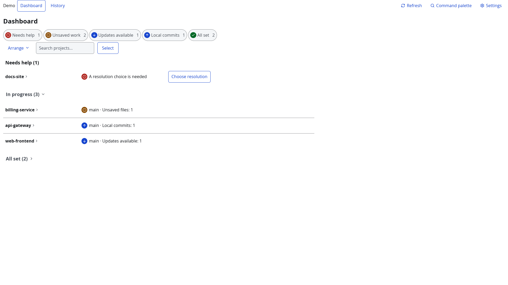

# knotra

[](https://github.com/nabbisen/knotra/blob/main/LICENSE)

A VCS-agnostic tool for inspecting, organizing, and visualizing changes. Git and Jujutsu supported.



---

## Overview

knotra is a local-first GUI application for developers and release managers
who work across multiple Git and Jujutsu (jj) repositories simultaneously.

It solves the problem of keeping your multi-repo workspace coherent: knowing
which repos are behind, which have uncommitted changes, and performing bulk
operations — fetches, context switches, release tagging — safely and atomically.

---

## Why knotra?

| Situation | Without knotra | With knotra |
|---|---|---|
| "Are all my repos up to date?" | `cd` into each, run `git status` | Dashboard card grid shows it instantly |
| "Update everything safely" | Manual loop, forget dirty repos | Smart Pull with dirty-state guard |
| "Tag v1.2.3 across 8 repos" | Run tag command 8 times, pray | Freezer validates, tags atomically, rolls back on failure |
| "What went wrong during the last release?" | Search terminal history | History screen with per-project logs |

---

## Install

- **Windows:** the Microsoft Store (search for "knotra"), or the Windows zip from
  [GitHub Releases](https://github.com/nabbisen/knotra/releases).
- **Linux:** the Linux archive from [GitHub Releases](https://github.com/nabbisen/knotra/releases).
  It includes knotra's desktop entry and icon.
- **macOS:** the macOS zip from [GitHub Releases](https://github.com/nabbisen/knotra/releases).
  knotra is not signed by Apple, so macOS stops it the first time you open it. To allow it, try
  to open knotra once, then go to **System Settings → Privacy & Security** and click
  **Open Anyway** (Apple shows it for about an hour after the attempt). See Apple's
  [Open a Mac app from an unknown developer](https://support.apple.com/guide/mac-help/open-a-mac-app-from-an-unknown-developer-mh40616/mac).
- **Any system with Rust:** `cargo install knotra`. This builds knotra on your own computer, so
  macOS does not ask you to allow it.

---

## Quick Start

```sh
# Build from source (requires Rust 2024 edition / rustc ≥ 1.88)
cargo build --release -p knotra

# Run
./target/release/knotra

# The first run creates ~/.config/knotra/config.toml with defaults.
# Add your repositories via Settings → Add Project.
```

---

## Features / Design Notes

- **Dashboard**: card-grid view of all registered projects — auto-grouped by attention tier (Needs Attention / Active / Clean).
- **Sync & Pull**: bulk fetch and Smart Pull with dirty-repo detection — opens as a modal from the selection bar.
- **Context Switch**: switch branch / change-set across projects from a single modal (`Ctrl+K` or **Switch…** button).
- **Freezer**: transactional cross-repo tag/bookmark creation with automatic rollback — opens as a modal from the selection bar.
- **History**: searchable operation log with copy-paste-friendly command output.
- **Accessible by Default**: keyboard navigation, sufficient contrast, labels on all status indicators.
- **Transparent**: every operation logs the VCS commands it executed and their output.
- **Local-first**: no cloud sync, no telemetry, no required external services.

---

## For more detail, see our full documentation

> docs/ — mdBook source (run `mdbook serve docs` to browse locally)

Key chapters:
- [Introduction & Features](docs/src/introduction.md)
- [Quick Start Tutorial](docs/src/quickstart.md)
- [Architecture](docs/src/contributing/architecture.md)
- [Contributing](.github/CONTRIBUTING.md)
